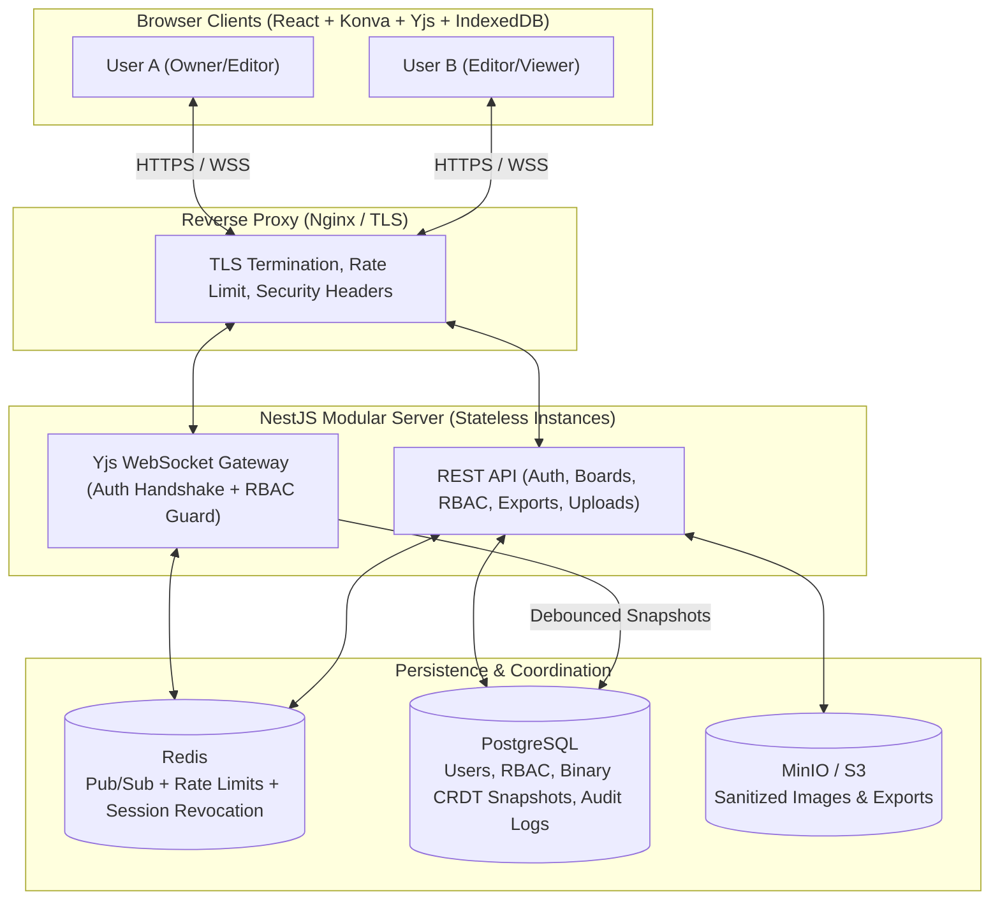

# SyncBoard — Production-Grade Collaborative Whiteboard Implementation Guide

> A complete, commit-by-commit engineering playbook for building **SyncBoard**, a high-performance, conflict-free, security-hardened real-time collaborative whiteboard with a clean, portfolio-ready GitHub repository.

---

## 1. Architectural Vision & Why This Design Wins

Most portfolio whiteboard projects broadcast raw JSON mouse/shape events over Socket.IO and write directly to a database. That approach breaks down quickly under real collaboration: concurrent edits overwrite each other, dragging shapes floods PostgreSQL with thousands of writes, and rendering stalls past a few hundred shapes.

**SyncBoard** solves these problems using production distributed-systems and graphics-engineering patterns:

1. **CRDT-First Real-Time Synchronization (`Yjs`):** Instead of fragile last-write-wins JSON patches, shared board state lives in a Conflict-Free Replicated Data Type (`Y.Doc`). Concurrent edits from 10–50+ simultaneous users mathematically converge to the exact same state without locks, even after temporary disconnects.
2. **Separated Ephemeral Presence vs. Durable State:** High-frequency cursor coordinates and active selections travel over Yjs Awareness (throttled to 30 Hz on the network, interpolated at 60 FPS on the client) and are **never** written to PostgreSQL. Durable board elements are synced via compact binary CRDT updates and flushed to PostgreSQL as debounced snapshots.
3. **Horizontal Scalability via Redis Pub/Sub:** Multiple WebSocket server instances share room state seamlessly through Redis channels, eliminating single-server bottlenecks.
4. **60 FPS Layered Canvas + Spatial Indexing:** The canvas is split into isolated Konva layers (Grid, Static Elements, Active Transform, Ephemeral Cursors) paired with an `rbush` R-Tree spatial index ($O(\log n)$ viewport culling) so moving a cursor or dragging one shape never re-renders the entire board.
5. **Defense-in-Depth Security:** Argon2id password hashing, rotating HttpOnly refresh tokens with reuse detection, server-side RBAC verification on every WebSocket CRDT update, strict CSP/Helmet headers, Redis sliding-window rate limiting, and sanitized isolated media storage.

### High-Level Architecture



---

## 2. UI/UX Design Direction (Modern, Human-Crafted, Zero "AI-Slop")

To make SyncBoard look like a carefully crafted product (comparable to Figma, Linear, Excalidraw, or Paper) rather than a generic AI-generated template, enforce these strict visual rules:

- **Avoid Generic AI Clichés:** No neon purple/cyan gradients, no glowing borders, no heavy glassmorphism over noisy backgrounds, no oversized marketing hero cards inside the app shell, and no cluttered multi-colored sidebars.
- **Tactile Studio Palette:**
  - **Light Mode (Default):** Warm architectural paper canvas (`#FAF9F6`), crisp white floating surfaces (`#FFFFFF`), subtle 24px dot-grid (`#E4E2DD`), deep charcoal ink (`#18181B`), muted stone secondary text (`#71717A`), and a single restrained cobalt accent (`#2563EB`) reserved strictly for active selections and primary actions.
  - **Dark Mode (Optional Toggle):** Deep neutral slate (`#141518`), elevated panels (`#1C1E22`), subtle grid (`#272930`), warm off-white ink (`#F4F4F5`).
- **Borders & Depth:** Use hairline `1px solid rgba(24, 24, 27, 0.08)` borders with tight, natural shadows (`0 4px 16px -2px rgba(0,0,0,0.06)`) instead of heavy drop shadows.
- **Typography Pairing:**
  - UI & Controls: `Inter` or `Plus Jakarta Sans` (clean, legible at 12px–14px).
  - Numeric Readouts (Zoom %, $X/Y$ coordinates, shortcut hints, version IDs): `JetBrains Mono` with `tabular-nums`.
- **Spatial Ergonomics (Canvas-First Layout):**
  - **95%+ of the viewport** belongs to the infinite canvas.
  - **Top-Left Floating Pill:** Back to Dashboard, editable board title, sync status indicator (Saved / Syncing / Offline).
  - **Top-Right Floating Pill:** Live collaborator avatars (with distinct muted pastel presence colors), Presentation Mode toggle, Share/Permissions button, Export menu.
  - **Bottom-Center Floating Tool Dock:** Crisp icon buttons with keyboard shortcut badges (`V`, `H`, `R`, `O`, `A`, `P`, `T`, `N`, `I`).
  - **Contextual Properties Panel:** Appears *only* when an object is selected or a drawing tool is active, keeping the workspace calm and uncluttered.

---

## 3. Tech Stack, Languages & Required Tools

### Languages & Core Stack

| Layer | Technology | Why It Is Chosen |
| --- | --- | --- |
| **Language** | TypeScript 5.x (Strict Mode) | End-to-end type safety across frontend, backend, and shared contracts |
| **Monorepo** | `pnpm` Workspaces + Turborepo | Fast incremental builds, strict dependency isolation, clean repo layout |
| **Frontend** | React 19 + Vite + Tailwind CSS v4 | Fast HMR, modern styling without runtime overhead |
| **Canvas Engine** | `konva` + `react-konva` + `perfect-freehand` + `rbush` | Retained-mode scene graph, smooth ink strokes, $O(\log n)$ spatial culling |
| **Client State** | Zustand + Yjs (`yjs`, `y-indexeddb`, `y-protocols`) | Minimal boilerplate for UI state; CRDT engine for shared document state |
| **Backend** | NestJS (Node.js 22 LTS) + `@nestjs/platform-ws` | Modular DI architecture, clean guards/pipes, raw WebSocket performance |
| **Database & ORM** | PostgreSQL 16 + Prisma ORM | Relational RBAC/metadata + binary `BYTEA` CRDT snapshots & audit logs |
| **Cache & Pub/Sub** | Redis 7 (`ioredis`) | Cross-instance WebSocket sync, rate limiting, refresh-token revocation |
| **Object Storage** | MinIO (local) / AWS S3 (prod) | Isolated storage for sanitized images & board exports |
| **Security** | `argon2`, `helmet`, `zod`, `sharp`, `isomorphic-dompurify` | Modern cryptography, strict schema validation, safe media sanitization |
| **Testing** | Vitest, Jest, Supertest, Playwright, k6 | Unit, integration, multi-browser E2E collaboration, and load testing |
| **DevOps** | Docker, Docker Compose, Nginx, GitHub Actions | Reproducible builds, hardened reverse proxy, automated CI/CD |

### Local Workstation Setup (Install Before Commit 1)

Install the following tools on your development machine:

```bash
# 1. Install Node.js 22 LTS (recommended via nvm)
nvm install 22
nvm use 22

# 2. Enable Corepack and install pnpm
corepack enable
corepack prepare pnpm@latest --activate

# 3. Verify Git, Node, pnpm, and Docker installations
git --version          # >= 2.40
node --version         # v22.x
pnpm --version         # >= 9.x
docker --version       # >= 26.x
docker compose version # >= 2.25
```

**Recommended IDE Setup (VS Code):** Install *ESLint*, *Prettier*, *Prisma*, *Tailwind CSS IntelliSense*, *Docker*, and *Error Lens*.

---

## 4. Target Clean GitHub Repository Structure

```text
syncboard/
├── .github/
│   └── workflows/
│       └── ci.yml                   # Lint, typecheck, test, audit, Docker build
├── apps/
│   ├── web/                         # React + Vite + Konva + Yjs client
│   │   ├── src/
│   │   │   ├── app/                 # Routing & providers
│   │   │   ├── features/
│   │   │   │   ├── auth/            # Login, register, token refresh interceptor
│   │   │   │   ├── dashboard/       # Boards list, folders, favorites, invites
│   │   │   │   ├── canvas/          # Konva stage, layers, tools, RBush index
│   │   │   │   ├── collab/          # Yjs provider, awareness, cursor smoothing
│   │   │   │   └── export/          # PNG, SVG, PDF exporters
│   │   │   ├── components/ui/       # Tactile minimalist design system primitives
│   │   │   ├── stores/              # Zustand UI & tool state
│   │   │   └── styles/              # Design tokens & Tailwind CSS
│   │   ├── Dockerfile
│   │   └── package.json
│   └── server/                      # NestJS HTTP API + Yjs WebSocket Gateway
│       ├── prisma/
│       │   ├── schema.prisma
│       │   └── migrations/
│       ├── src/
│       │   ├── common/              # Guards, filters, interceptors, rate limits
│       │   ├── modules/
│       │   │   ├── auth/            # Argon2id, JWT, rotating refresh tokens
│       │   │   ├── boards/          # Board CRUD, folders, snapshots, restore
│       │   │   ├── permissions/     # RBAC (Owner/Editor/Commenter/Viewer)
│       │   │   ├── collab/          # Yjs WS gateway, Redis Pub/Sub, RBAC sync guard
│       │   │   ├── uploads/         # Magic-byte validation, Sharp/SVG sanitization
│       │   │   └── audit/           # Structured security & activity logs
│       │   └── main.ts
│       ├── Dockerfile
│       └── package.json
├── packages/
│   └── shared/                      # Canonical types, Zod schemas, geometry utils
│       ├── src/
│       │   ├── schemas/             # Element, board, auth, permission Zod schemas
│       │   ├── geometry/            # Bounding box, connector anchor math
│       │   └── constants/           # Limits, roles, protocol opcodes
│       └── package.json
├── docker/
│   └── nginx/
│       └── nginx.conf               # Hardened reverse proxy + WebSocket upgrade
├── docs/
│   ├── REQUIREMENTS.md              # Functional, non-functional & security specs
│   ├── ENGINEERING_REPORT.md        # Single consolidated technical & security report
│   └── assets/                      # Screenshots, GIF demos, exported diagrams
├── tests/
│   ├── e2e/                         # Playwright multi-user collaboration specs
│   └── load/                        # k6 WebSocket concurrency benchmarks
├── docker-compose.yml               # Local dev services (Postgres, Redis, MinIO)
├── docker-compose.prod.yml          # Full production stack
├── .env.example                     # Documented environment template (no secrets)
├── .editorconfig
├── .gitignore
├── turbo.json
├── pnpm-workspace.yaml
├── package.json
├── CONTRIBUTING.md
├── SECURITY.md
├── LICENSE
└── README.md
```

---

## 5. Git Conventions & Documentation Strategy

### Conventional Commits Standard

Every commit must follow the [Conventional Commits](https://www.conventionalcommits.org/) specification:
`<type>(<scope>): <concise imperative summary>`

- Allowed types: `feat`, `fix`, `perf`, `security`, `refactor`, `test`, `docs`, `chore`, `ci`.
- **Golden Rule:** Never bundle unrelated features, security fixes, and refactors into a single commit. Keep each commit atomic, buildable, and reviewable.

### Required GitHub Repository Files

1. **`README.md`:** Make it crisp and impressive without bloat. Include:
   - Custom minimal header banner + clean status badges (CI, TypeScript, License, Docker).
   - 2-sentence elevator pitch + high-resolution screenshot/GIF of two cursors collaborating on a clean architectural diagram.
   - Core Engineering Highlights table (CRDT sync, 60 FPS spatial culling, RBAC, Security hardening).
   - Embedded Mermaid architecture diagram.
   - 5-step Quick Start (`git clone`, `cp .env.example .env`, `docker compose up -d`, `pnpm install`, `pnpm dev`).
   - Links to `docs/REQUIREMENTS.md`, `docs/ENGINEERING_REPORT.md`, and `SECURITY.md`.
2. **`docs/REQUIREMENTS.md`:** Formal Software Requirements Specification (SRS) detailing Functional Requirements (FR-1 to FR-20), Non-Functional Requirements (NFR latency/FPS targets), and Security Requirements (SR-1 to SR-10).
3. **`docs/ENGINEERING_REPORT.md`:** A **single, living English technical report** updated at the end of every phase. Every section records architectural decisions, trade-offs, performance measurements, and security controls implemented during that phase. (A complete template is provided in Section 7.)
4. **Dependency Manifests (`package.json` + `pnpm-lock.yaml`):** In the Node/TypeScript ecosystem, `package.json` + `pnpm-lock.yaml` serve as the exact, reproducible equivalent of Python's `requirements.txt`. Always commit `pnpm-lock.yaml` so builds are deterministic.

---

## 6. Step-by-Step, Commit-by-Commit Implementation Plan

Follow these 7 phases and **42 atomic commits** in exact order. Verify that the app builds and tests pass before every commit.

---

### Phase 0: Repository Foundation & Engineering Standards

#### Commit 1 — Initialize Monorepo & Git Hygiene
- **Commands:**
  ```bash
  mkdir syncboard && cd syncboard
  git init -b main
  pnpm init
  ```
- **Tasks:**
  1. Create `pnpm-workspace.yaml` declaring `apps/*` and `packages/*`.
  2. Create `turbo.json` with `build`, `dev`, `lint`, `typecheck`, and `test` pipelines.
  3. Add a comprehensive `.gitignore` (ignoring `node_modules`, `.env`, `.env.local`, `dist`, `.turbo`, `coverage`, `.DS_Store`, `*.log`).
  4. Add `.editorconfig` (2 spaces, UTF-8, LF line endings) and `LICENSE` (MIT).
  5. Create `.env.example` with placeholder keys for `DATABASE_URL`, `REDIS_URL`, `JWT_ACCESS_SECRET`, `JWT_REFRESH_SECRET`, `MINIO_ENDPOINT`, `MINIO_ACCESS_KEY`, `MINIO_SECRET_KEY`, and `CORS_ORIGIN`.
- **Commit:**
  ```bash
  git add .
  git commit -m "chore(repo): initialize pnpm Turborepo workspace, git hygiene, and env template"
  ```

#### Commit 2 — Requirements Spec, Security Policy & Report Scaffold
- **Tasks:**
  1. Create `docs/REQUIREMENTS.md` defining:
     - **Functional Requirements:** Drawing tools, infinite canvas, multi-user CRDT sync, RBAC (Owner, Editor, Commenter, Viewer), dashboard, smart connectors, presentation mode, version history, exports.
     - **Non-Functional Requirements:** Cursor latency $< 60\text{ ms}$ p95, canvas frame time $\le 16.6\text{ ms}$ (60 FPS) with $5{,}000$ objects, support $\ge 20$ concurrent editors per board without data loss.
     - **Security Requirements:** Zero plaintext secrets, server-enforced RBAC on HTTP and WebSockets, XSS/CSRF/SSRF/DoS mitigations.
  2. Create `SECURITY.md` (vulnerability disclosure policy, supported versions, threat boundaries) and `CONTRIBUTING.md` (branching, commit style, PR checklist).
  3. Create `docs/ENGINEERING_REPORT.md` using the master template in Section 7 and complete **Section 1 (System Scope & Architecture Baseline)**.
- **Commit:**
  ```bash
  git add docs/ SECURITY.md CONTRIBUTING.md
  git commit -m "docs(specs): add requirements spec, security policy, and engineering report scaffold"
  ```

#### Commit 3 — Strict TypeScript, Linting, Formatting & Git Hooks
- **Commands:**
  ```bash
  pnpm add -Dw turbo typescript eslint prettier husky lint-staged @commitlint/cli @commitlint/config-conventional
  pnpm exec husky init
  ```
- **Tasks:**
  1. Create root `tsconfig.base.json` with `"strict": true`, `"noUncheckedIndexedAccess": true`, `"exactOptionalPropertyTypes": true`, and `"noImplicitOverride": true`.
  2. Configure flat ESLint (`eslint.config.mjs`) and Prettier (`.prettierrc`).
  3. Configure `.husky/pre-commit` to run `lint-staged` and `.husky/commit-msg` to enforce Conventional Commits via `commitlint`.
- **Commit:**
  ```bash
  git add package.json pnpm-lock.yaml tsconfig.base.json eslint.config.mjs .prettierrc .husky/ commitlint.config.mjs
  git commit -m "chore(tooling): configure strict TypeScript, ESLint, Prettier, Husky, and commitlint"
  ```

#### Commit 4 — Local Development Infrastructure (Docker Compose)
- **Tasks:**
  1. Create `docker-compose.yml` running:
     - `postgres:16-alpine` with healthcheck and named volume.
     - `redis:7-alpine` with `appendonly yes` and password authentication.
     - `minio/minio` for local S3-compatible image/export storage.
  2. Run `docker compose up -d` and verify all three containers pass healthchecks.
- **Commit:**
  ```bash
  git add docker-compose.yml
  git commit -m "chore(infra): add local Docker Compose stack for PostgreSQL, Redis, and MinIO"
  ```

---

### Phase 1: Shared Domain Contracts & Database Schema

#### Commit 5 — Shared Types, Zod Schemas & Geometry Utilities
- **Tasks:**
  1. Create `packages/shared` (`package.json`, `tsconfig.json`).
  2. Install `zod` in `packages/shared`.
  3. Define discriminated union schemas for every canvas object:
     - `RectangleElement`, `EllipseElement`, `LineElement`, `ArrowElement` (with optional `startBinding` and `endBinding` IDs for smart connectors), `FreehandPathElement`, `TextElement`, `StickyNoteElement`, `ImageElement`, `FrameElement`.
     - Common fields: `id` (UUID/nanoid), `type`, `x`, `y`, `width`, `height`, `rotation`, `zIndex` (fractional indexing string so reordering never conflicts in CRDTs!), `groupId`, `style` (`fill`, `stroke`, `strokeWidth`, `opacity`, `roughness`), `locked`, `updatedAt`.
  4. Define RBAC role enum (`OWNER`, `EDITOR`, `COMMENTER`, `VIEWER`) and shared API/WebSocket protocol constants.
  5. Add pure geometry helpers (`getElementBounds`, `rectsIntersect`, `computeConnectorEndpoints`).
- **Commit:**
  ```bash
  git add packages/shared pnpm-lock.yaml
  git commit -m "feat(shared): define canonical whiteboard element schemas, RBAC roles, and geometry helpers"
  ```

#### Commit 6 — Prisma Database Schema & Initial Migration
- **Commands:**
  ```bash
  mkdir -p apps/server && cd apps/server
  pnpm init
  pnpm add @prisma/client
  pnpm add -D prisma
  pnpm exec prisma init
  ```
- **Tasks:**
  1. Design `apps/server/prisma/schema.prisma` with cleanly indexed relational models:
     - `User` (`id`, `email` unique, `username` unique, `displayName`, `passwordHash`, `avatarColor`, `createdAt`, `updatedAt`).
     - `RefreshToken` (`id`, `userId`, `tokenHash` unique, `familyId`, `expiresAt`, `revokedAt`, `replacedByTokenId`, `ipAddress`, `userAgent`).
     - `Board` (`id`, `title`, `ownerId`, `folderName`, `isFavorite`, `isArchived`, `yjsState` `Bytes` for latest compacted CRDT binary state, `stateVersion` `Int`, `shareToken` unique nullable, `shareRole`, `createdAt`, `updatedAt`).
     - `BoardMember` (`id`, `boardId`, `userId`, `role`, `createdAt`, unique constraint on `(boardId, userId)`).
     - `BoardSnapshot` (`id`, `boardId`, `createdById`, `label`, `yjsState` `Bytes`, `createdAt`) — powers Version History!
     - `BoardComment` (`id`, `boardId`, `authorId`, `x`, `y`, `elementId` nullable, `body`, `resolved`, `parentId` nullable, `createdAt`).
     - `AuditLog` (`id`, `actorId`, `boardId` nullable, `action`, `metadata` `Json`, `ipAddress`, `createdAt`).
  2. Run `pnpm exec prisma migrate dev --name init_schema` and `pnpm exec prisma generate`.
- **Commit:**
  ```bash
  git add apps/server/prisma apps/server/package.json pnpm-lock.yaml
  git commit -m "feat(db): design Prisma schema for users, refresh tokens, boards, RBAC, snapshots, and audit logs"
  ```

#### Commit 7 — Phase 1 Engineering Report Update
- **Tasks:**
  1. Update `docs/ENGINEERING_REPORT.md` — complete **Section 2 (Data Modeling & Persistence Strategy)** explaining why `BYTEA` CRDT state snapshots + fractional `zIndex` outperform row-per-shape JSONB updates under high concurrency.
- **Commit:**
  ```bash
  git add docs/ENGINEERING_REPORT.md
  git commit -m "docs(report): document domain schemas, fractional indexing, and database persistence model"
  ```

---

### Phase 2: High-Performance Local Canvas Engine

#### Commit 8 — Scaffold React Frontend & Tactile Studio Design System
- **Commands:**
  ```bash
  pnpm create vite apps/web --template react-ts
  cd apps/web
  pnpm add tailwindcss @tailwindcss/vite lucide-react zustand clsx tailwind-merge
  ```
- **Tasks:**
  1. Configure Tailwind CSS v4 with custom CSS variables for the Warm Paper light theme (`#FAF9F6`) and Neutral Slate dark theme (`#141518`).
  2. Load `Inter` and `JetBrains Mono` fonts cleanly.
  3. Build minimal, accessible UI primitives in `src/components/ui/` (`Button`, `IconButton`, `Tooltip`, `Popover`, `Modal`, `Dropdown`, `Badge`) with hairline borders and subtle focus rings.
  4. Build the canvas shell layout: floating top-left header, top-right utility bar, bottom-center tool dock, and conditional right-hand inspector.
- **Commit:**
  ```bash
  git add apps/web pnpm-lock.yaml
  git commit -m "feat(web): scaffold React Vite frontend and tactile minimalist design system"
  ```

#### Commit 9 — Infinite Pan & Zoom Konva Stage with Dot-Grid Layer
- **Commands:**
  ```bash
  pnpm --filter web add konva react-konva
  ```
- **Tasks:**
  1. Create a Zustand store (`useViewportStore`) managing camera `x`, `y`, and `scale` (clamped between `0.1` and `5.0`).
  2. Implement smooth cursor-centered wheel zooming (`Ctrl/Cmd + Wheel` or pinch-to-zoom) and panning (middle-mouse drag, Spacebar + drag, or Hand tool `H`).
  3. Render an infinite architectural dot grid in a dedicated non-interactive `GridLayer` (`listening={false}`) that dynamically adjusts dot spacing across zoom levels so the grid never becomes visual noise.
  4. Display live zoom percentage in `JetBrains Mono` with one-click reset (`100%`) and Fit-to-Content (`Shift+1`).
- **Commit:**
  ```bash
  git add apps/web/src/features/canvas apps/web/src/stores apps/web/package.json pnpm-lock.yaml
  git commit -m "feat(canvas): implement infinite pan-and-zoom Konva stage with adaptive dot-grid layer"
  ```

#### Commit 10 — Core Drawing & Authoring Tools
- **Commands:**
  ```bash
  pnpm --filter web add perfect-freehand nanoid
  ```
- **Tasks:**
  1. Implement tool state machine (`select`, `hand`, `rectangle`, `ellipse`, `line`, `arrow`, `pen`, `eraser`, `text`, `sticky`, `image`).
  2. Build pointer-event drawing handlers (converting screen pointer coordinates to world canvas coordinates via inverse stage transform).
  3. Use `perfect-freehand` to convert raw pointer streams into smooth, tapered SVG/Canvas paths for the Pen tool.
  4. Implement inline rich-feel editing for `Text` and `StickyNote` (overlaying a positioned `<textarea>` synced seamlessly to canvas zoom and coordinates on double-click).
  5. Build the contextual style inspector (curated muted color swatches, stroke width, dash style, opacity, font size).
- **Commit:**
  ```bash
  git add apps/web/src/features/canvas apps/web/package.json pnpm-lock.yaml
  git commit -m "feat(canvas): add shape, freehand pen, arrow, text, sticky note, and eraser tools"
  ```

#### Commit 11 — Selection, Transformer, Multi-Select, Grouping & Clipboard
- **Tasks:**
  1. Implement single-click selection and marquee drag-box selection (`SelectionRect`).
  2. Attach a Konva `Transformer` to selected nodes with live resize, rotation, aspect-ratio lock (`Shift`), and clean visual handles.
  3. Implement `Group` (`Ctrl/Cmd + G`) and `Ungroup` (`Ctrl/Cmd + Shift + G`) using shared `groupId` metadata.
  4. Implement Copy/Paste/Duplicate (`Ctrl/Cmd + C/V/D`) with smart offset placement, Delete/Backspace, layer ordering (`[` / `]`), and snap-to-grid / alignment guides.
- **Commit:**
  ```bash
  git add apps/web/src/features/canvas
  git commit -m "feat(canvas): add marquee multi-select, Konva transformer, grouping, clipboard, and shortcuts"
  ```

#### Commit 12 — Canvas Performance Optimization (Spatial Index & Layer Isolation)
- **Commands:**
  ```bash
  pnpm --filter web add rbush
  pnpm --filter web add -D @types/rbush
  ```
- **Tasks:**
  1. Separate Konva into 4 distinct `<Layer>` stacks:
     - `GridLayer` (`listening={false}`, static background).
     - `StaticElementsLayer` (unselected elements).
     - `ActiveElementsLayer` (currently dragged/transformed elements + `Transformer`).
     - `OverlayLayer` (selection box, alignment guides, and later live cursors).
  2. Maintain an `rbush` R-Tree index of element bounding boxes (`minX`, `minY`, `maxX`, `maxY`, `id`).
  3. Compute the padded viewport world rectangle on pan/zoom and query `rbush.search(viewportRect)` so only visible elements mount to Konva.
  4. Memoize individual shape components with `React.memo` and disable `perfectDrawEnabled` / unnecessary shadow hit-graphs where appropriate.
  5. Add a dev-only stress-test utility to spawn $5{,}000$ shapes and record FPS via Chrome DevTools Performance panel.
- **Commit:**
  ```bash
  git add apps/web/src/features/canvas apps/web/package.json pnpm-lock.yaml
  git commit -m "perf(canvas): add RBush spatial indexing, viewport culling, and 4-layer Konva isolation"
  ```

#### Commit 13 — Phase 2 Engineering Report Update
- **Tasks:**
  1. Update `docs/ENGINEERING_REPORT.md` — complete **Section 3 (Canvas Rendering Pipeline & Performance Benchmarks)** with before/after FPS and frame-time metrics for $500$, $2{,}000$, and $5{,}000$ objects.
- **Commit:**
  ```bash
  git add docs/ENGINEERING_REPORT.md
  git commit -m "docs(report): document canvas architecture, spatial culling, and 60 FPS benchmark results"
  ```

---

### Phase 3: Backend Core, Authentication & Board Management

#### Commit 14 — Scaffold Modular NestJS Backend
- **Commands:**
  ```bash
  pnpm --filter server add @nestjs/common @nestjs/core @nestjs/platform-express @nestjs/config @nestjs/websockets @nestjs/platform-ws ioredis zod reflect-metadata rxjs
  pnpm --filter server add -D @nestjs/cli @nestjs/testing ts-node
  ```
- **Tasks:**
  1. Bootstrap NestJS with `WsAdapter`, structured JSON logging (`nestjs-pino`), and strict Zod environment validation at startup (fail fast if secrets are missing).
  2. Create global `PrismaModule` and `RedisModule` with graceful shutdown hooks (`onModuleDestroy`).
  3. Add `/health` (liveness) and `/health/ready` (verifies PostgreSQL + Redis connectivity) endpoints.
- **Commit:**
  ```bash
  git add apps/server pnpm-lock.yaml
  git commit -m "feat(api): scaffold NestJS backend with validated config, Prisma/Redis modules, and health checks"
  ```

#### Commit 15 — Authentication with Argon2id & Rotating Refresh Tokens
- **Commands:**
  ```bash
  pnpm --filter server add argon2 @nestjs/jwt cookie-parser
  pnpm --filter server add -D @types/cookie-parser
  ```
- **Tasks:**
  1. Implement `POST /api/v1/auth/register`, `POST /api/v1/auth/login`, `POST /api/v1/auth/refresh`, `POST /api/v1/auth/logout`, and `GET /api/v1/auth/me`.
  2. Hash passwords with **Argon2id** (`memoryCost: 65536`, `timeCost: 3`, `parallelism: 1`).
  3. Issue short-lived Access JWTs ($15\text{ min}$) returned in memory on the client, paired with opaque high-entropy Refresh Tokens stored in `HttpOnly`, `Secure`, `SameSite=Lax` cookies and hashed (SHA-256) in the `RefreshToken` table.
  4. Build clean Login & Register pages in `apps/web` with silent token refresh interceptor.
- **Commit:**
  ```bash
  git add apps/server/src/modules/auth apps/web/src/features/auth apps/server/package.json pnpm-lock.yaml
  git commit -m "feat(auth): implement Argon2id auth, short-lived JWTs, and HttpOnly refresh token flow"
  ```

#### Commit 16 — Board Management API & Workspace Dashboard
- **Tasks:**
  1. Implement backend endpoints:
     - `GET /api/v1/boards` (filter by recent, owned, shared, favorites, folder, search query; cursor pagination).
     - `POST /api/v1/boards` (create blank board or from built-in template: Architecture Diagram, Flowchart, Mind Map).
     - `PATCH /api/v1/boards/:id` (rename, folder, favorite, archive).
     - `POST /api/v1/boards/:id/duplicate` (clones latest CRDT snapshot into a new board).
     - `DELETE /api/v1/boards/:id` (soft/hard delete by Owner).
  2. Build the minimalist Dashboard UI in `apps/web`: clean sidebar (Recent, Starred, Shared with me, Folders), card grid with subtle preview thumbnails, quick search (`Cmd/Ctrl + K`), and one-click board creation.
- **Commit:**
  ```bash
  git add apps/server/src/modules/boards apps/web/src/features/dashboard
  git commit -m "feat(boards): build board management REST API and workspace dashboard UI"
  ```

#### Commit 17 — Role-Based Access Control (RBAC) & Invite Links
- **Tasks:**
  1. Implement `PermissionsService` and `@RequireBoardRole(Role.EDITOR)` NestJS Guard checking `Board.ownerId` and `BoardMember.role` against a strict hierarchy (`OWNER > EDITOR > COMMENTER > VIEWER`).
  2. Implement member management endpoints: invite user by email/username, change role, revoke access, generate/rotate/disable shareable invite links (with configurable default role: `VIEWER`, `COMMENTER`, or `EDITOR`).
  3. Build the Share & Permissions modal in `apps/web` showing current members, role dropdowns, revoke buttons, and copyable invite link.
  4. Enforce UI read-only mode when logged in as `VIEWER` or `COMMENTER`.
- **Commit:**
  ```bash
  git add apps/server/src/modules/permissions apps/web/src/features/dashboard apps/web/src/features/canvas
  git commit -m "feat(rbac): implement Owner, Editor, Commenter, Viewer guards and share link management"
  ```

#### Commit 18 — Phase 3 Engineering Report Update
- **Tasks:**
  1. Update `docs/ENGINEERING_REPORT.md` — complete **Section 4 (Authentication Lifecycle & RBAC Enforcement Matrix)**.
- **Commit:**
  ```bash
  git add docs/ENGINEERING_REPORT.md
  git commit -m "docs(report): document authentication flow, token lifecycle, and RBAC permission matrix"
  ```

---

### Phase 4: Real-Time CRDT Collaboration Engine

#### Commit 19 — Frontend Yjs CRDT Document Model & Collaborative Undo/Redo
- **Commands:**
  ```bash
  pnpm --filter web add yjs y-protocols lib0 y-indexeddb
  ```
- **Tasks:**
  1. Replace local-only element array state with a `Y.Doc` containing a `Y.Map<Y.Map<unknown>>` named `elements` (keyed by element `id`).
  2. Wrap mutations inside `ydoc.transact(() => { ... }, LOCAL_ORIGIN)` so multi-shape drags, pastes, and deletes are atomic operations.
  3. Attach `Y.UndoManager` scoped strictly to `LOCAL_ORIGIN` so pressing `Ctrl/Cmd + Z` undoes **only your own edits** without reverting another collaborator's work!
  4. Subscribe React/Konva rendering and the `rbush` spatial index to `elements.observeDeep(...)` incremental diffs.
- **Commit:**
  ```bash
  git add apps/web/src/features/collab apps/web/src/features/canvas apps/web/package.json pnpm-lock.yaml
  git commit -m "feat(collab): integrate Yjs CRDT document store and user-scoped UndoManager"
  ```

#### Commit 20 — Authenticated Yjs WebSocket Sync Gateway
- **Commands:**
  ```bash
  pnpm --filter server add yjs y-protocols lib0
  ```
- **Tasks:**
  1. Build a binary WebSocket gateway (`CollabGateway`) at `/ws/boards/:boardId`.
  2. Authenticate every WebSocket upgrade using a short-lived single-use **WS Ticket** obtained from `POST /api/v1/boards/:id/ws-ticket` (avoids putting long-lived JWTs in URL query strings that leak into server/proxy logs!).
  3. On connection: resolve user's board `Role`, load/hydrate room `Y.Doc` from PostgreSQL if not already warm in memory, run the Yjs Sync Step 1 & Step 2 binary handshake (`y-protocols/sync`), and attach the socket to the room.
  4. Build the client `YjsWebSocketProvider` in `apps/web` with exponential backoff reconnection and connection-state badge (`Connected`, `Reconnecting...`, `Offline`).
- **Commit:**
  ```bash
  git add apps/server/src/modules/collab apps/web/src/features/collab apps/server/package.json pnpm-lock.yaml
  git commit -m "feat(collab): build ticket-authenticated Yjs WebSocket gateway and client sync provider"
  ```

#### Commit 21 — Redis Pub/Sub Multi-Instance Synchronization
- **Tasks:**
  1. Wire dedicated Redis Publisher and Subscriber connections in `CollabService`.
  2. When a server instance receives a validated Yjs binary update or awareness broadcast for `boardId`, publish it (tagged with `instanceId` to prevent echo loops) to `syncboard:room:{boardId}:updates` and `syncboard:room:{boardId}:awareness`.
  3. Subscribe dynamically when the first client joins a room on that instance, and clean up/unsubscribe (after flushing state) when the last client disconnects.
  4. Verify horizontal scaling locally by running two server instances on different ports sharing the same Redis instance.
- **Commit:**
  ```bash
  git add apps/server/src/modules/collab
  git commit -m "feat(collab): add Redis Pub/Sub room bridge for horizontal WebSocket scaling"
  ```

#### Commit 22 — Live Multiplayer Cursors, Presence & 60 FPS Interpolation
- **Tasks:**
  1. Broadcast cursor world coordinates `{ x, y }`, active tool, and selected element IDs via Yjs `Awareness` protocol, throttled to **30 Hz** ($33\text{ ms}$) on the sender.
  2. Render remote cursors on the top-most `OverlayLayer` with crisp custom SVG pointers and user name pills colored with each collaborator's assigned accent color.
  3. Implement `requestAnimationFrame` linear interpolation (`lerp`) between incoming cursor packets so remote pointers glide smoothly at 60 FPS even over variable network jitter.
  4. Highlight elements currently selected by other users with a subtle dashed outline in that user's presence color.
  5. Display live collaborator count and avatar stack in the top-right pill.
- **Commit:**
  ```bash
  git add apps/web/src/features/collab apps/web/src/features/canvas
  git commit -m "feat(collab): add live multiplayer cursors with 60 FPS interpolation and presence indicators"
  ```

#### Commit 23 — Debounced CRDT Persistence & Offline-First IndexedDB Sync
- **Tasks:**
  1. On the server, implement a debounced persistence worker per active room: flush compacted `Y.encodeStateAsUpdate(doc)` to PostgreSQL (`Board.yjsState`) every $3\text{ seconds}$ of activity, on a max $15\text{ second}$ ceiling during continuous drawing, and immediately when the last editor leaves a room.
  2. Add optimistic concurrency check (`stateVersion`) or Redis distributed lock during room eviction so two instances never clobber a snapshot.
  3. On the client, attach `IndexeddbPersistence` (`y-indexeddb`) so users can keep sketching offline and automatically merge conflict-free upon reconnecting.
- **Commit:**
  ```bash
  git add apps/server/src/modules/collab apps/web/src/features/collab
  git commit -m "perf(collab): implement debounced CRDT snapshot persistence and offline IndexedDB sync"
  ```

#### Commit 24 — Phase 4 Engineering Report Update
- **Tasks:**
  1. Update `docs/ENGINEERING_REPORT.md` — complete **Section 5 (Real-Time Distributed Sync, CRDT Convergence & Offline Resilience)**.
- **Commit:**
  ```bash
  git add docs/ENGINEERING_REPORT.md
  git commit -m "docs(report): document Yjs CRDT protocol, Redis Pub/Sub fanout, and persistence batching"
  ```

---

### Phase 5: Advanced Product Features

#### Commit 25 — Smart Connectors (Dynamic Shape-Bound Arrows)
- **Tasks:**
  1. When drawing or dragging an arrow endpoint near a shape's edge, snap to anchor points (top, right, bottom, left, or perimeter intersection) and store `{ startBinding: { elementId, anchor }, endBinding: { elementId, anchor } }`.
  2. Whenever a bound shape moves, resizes, or rotates, recalculate attached arrow endpoints in the same Yjs transaction so all collaborators see smooth connected diagrams.
  3. Add optional orthogonal (elbow) routing for clean architecture diagrams and flowcharts.
- **Commit:**
  ```bash
  git add packages/shared/src/geometry apps/web/src/features/canvas
  git commit -m "feat(canvas): implement smart connectors with live anchor tracking and elbow routing"
  ```

#### Commit 26 — Presentation Mode (Follow-Me) & Pinned Comments
- **Tasks:**
  1. **Presentation Mode:** Allow an Owner/Editor to click *Present* (broadcasting their viewport `{ x, y, scale }` via Awareness). Other users see a clean banner (*"Following [Name] — Click anywhere to stop"*) and smoothly animate their camera to track the presenter.
  2. **Contextual Comments:** Allow `OWNER`, `EDITOR`, and `COMMENTER` roles to drop comment pins at `(x, y)` coordinates or attached to elements, with threaded replies and resolve toggles persisted via REST API and broadcast in real time.
- **Commit:**
  ```bash
  git add apps/server/src/modules/boards apps/web/src/features/collab apps/web/src/features/canvas
  git commit -m "feat(collab): add Presentation follow-me mode and pinned contextual comment threads"
  ```

#### Commit 27 — Version History & Point-in-Time Restore
- **Tasks:**
  1. Automatically capture periodic `BoardSnapshot` records (e.g., every 10 minutes of active editing) plus allow manual named checkpoints (*"Save Version"*).
  2. Build a slide-over Version History drawer in `apps/web` allowing Owners/Editors to preview any historical snapshot in read-only mode (by hydrating a temporary local `Y.Doc`) and click **Restore** (which applies a fresh transaction to the live room so all connected clients smoothly transition to the restored state while preserving the pre-restore version as a safety checkpoint).
- **Commit:**
  ```bash
  git add apps/server/src/modules/boards apps/web/src/features/canvas
  git commit -m "feat(boards): implement version history snapshots, read-only preview, and safe restore"
  ```

#### Commit 28 — Export Engine (PNG, SVG, PDF) & Image Upload Pipeline
- **Commands:**
  ```bash
  pnpm --filter web add jspdf
  pnpm --filter server add @aws-sdk/client-s3 @aws-sdk/s3-request-presigner
  ```
- **Tasks:**
  1. **Exports:** Compute exact bounding box of all elements (or current selection) with clean padding:
     - **High-DPI PNG:** Render offscreen Konva stage at `pixelRatio: 2` or `3` with optional transparent or paper background.
     - **Clean Vector SVG:** Serialize canonical element models into crisp, standards-compliant SVG markup (not a raster wrapper!).
     - **PDF:** Generate clean vector/high-DPI PDF via `jspdf` matching board aspect ratio.
  2. **Image Uploads:** Implement `POST /api/v1/boards/:id/uploads` storing media in MinIO/S3 and returning a board-scoped URL for `ImageElement` rendering.
- **Commit:**
  ```bash
  git add apps/web/src/features/export apps/server/src/modules/uploads apps/web/package.json apps/server/package.json pnpm-lock.yaml
  git commit -m "feat(export): add high-DPI PNG, clean SVG, PDF exports and S3/MinIO image uploads"
  ```

#### Commit 29 — Phase 5 Engineering Report Update
- **Tasks:**
  1. Update `docs/ENGINEERING_REPORT.md` — complete **Section 6 (Advanced Features: Smart Connectors, Versioning & Export Pipeline)**.
- **Commit:**
  ```bash
  git add docs/ENGINEERING_REPORT.md
  git commit -m "docs(report): document smart connector math, version history restore, and export pipeline"
  ```

---

### Phase 6: Dedicated Security Hardening (Separate Atomic Commits)

> Every security control gets its own clean commit so reviewers and recruiters can inspect your security engineering discipline directly in `git log`.

#### Commit 30 — HTTP Security Headers, Strict CSP, CORS & CSRF Protection
- **Commands:**
  ```bash
  pnpm --filter server add helmet
  ```
- **Tasks:**
  1. Configure `helmet()` with strict `Content-Security-Policy` (`default-src 'self'`, disallowing `unsafe-eval`, locking `connect-src` to API/WSS origins and `img-src` to self/S3/blob/data).
  2. Configure explicit CORS allowlist (never `*` with `credentials: true`).
  3. Enforce CSRF protection on cookie-authenticated endpoints (`/auth/refresh`, `/auth/logout`) using `Origin`/`Referer` verification + custom non-simple header (`X-Requested-With` or double-submit CSRF token).
  4. Enable global validation pipes stripping unknown properties (`whitelist: true`, `forbidNonWhitelisted: true`) to block mass-assignment attacks.
- **Commit:**
  ```bash
  git add apps/server/src/main.ts apps/server/src/common apps/web/src/features/auth apps/server/package.json pnpm-lock.yaml
  git commit -m "security(http): enforce Helmet CSP headers, strict CORS allowlist, CSRF guard, and DTO stripping"
  ```

#### Commit 31 — Redis-Backed Sliding-Window Rate Limiting (HTTP & WebSocket)
- **Commands:**
  ```bash
  pnpm --filter server add @nestjs/throttler
  ```
- **Tasks:**
  1. Implement Redis-backed tiered rate limits:
     - Strict brute-force protection on `/auth/login` and `/auth/register` (e.g., 5 requests / minute per IP + account lockout/backoff).
     - Moderate limits on board creation, invite generation, and uploads.
     - Per-socket token bucket on WebSocket frames (e.g., max 120 messages/sec burst, auto-disconnect on sustained flood).
  2. Return standard `Retry-After` and `X-RateLimit-*` headers.
- **Commit:**
  ```bash
  git add apps/server/src/common apps/server/src/modules/collab apps/server/package.json pnpm-lock.yaml
  git commit -m "security(rate-limit): add Redis sliding-window rate limits for Auth, API, and WebSockets"
  ```

#### Commit 32 — WebSocket RBAC Enforcement & CRDT Payload Hardening
- **Tasks:**
  1. **Critical CRDT Security Control:** In `CollabGateway`, inspect every incoming binary Yjs message type (`messageSync` vs `messageAwareness`):
     - If the user's role is `VIEWER` or `COMMENTER`, **reject and drop** all Yjs document write updates (`syncStep2` / `update`) while still permitting read-only `syncStep1` and optionally presence awareness!
     - Re-verify role revocation in real time via a Redis pub/sub channel (`syncboard:revoke:{boardId}:{userId}`) so revoking a user's access immediately kicks or downgrades their live WebSocket connection!
  2. Enforce hard WebSocket `maxPayload` limits (e.g., `1 MiB` per frame) and maximum document size limits to mitigate memory-exhaustion / malicious Yjs binary bombs.
  3. Sanitize all user-supplied display names and text content rendered in DOM overlays to prevent stored XSS.
- **Commit:**
  ```bash
  git add apps/server/src/modules/collab apps/server/src/modules/permissions
  git commit -m "security(ws): enforce server-side RBAC on CRDT mutations, live revocation, and payload caps"
  ```

#### Commit 33 — Safe File Upload & Media Sanitization
- **Commands:**
  ```bash
  pnpm --filter server add sharp file-type isomorphic-dompurify
  ```
- **Tasks:**
  1. Never trust `file.mimetype` or file extensions. Inspect binary **magic bytes** via `file-type` and restrict uploads to PNG, JPEG, WebP, and optionally SVG.
  2. Enforce strict file size limits (e.g., $5\text{ MB}$) and maximum pixel dimensions (prevent decompression/pixel bombs).
  3. Re-encode raster images through `sharp` to strip EXIF metadata (GPS/camera data) and neutralize polyglot payloads.
  4. If SVG uploads are allowed, sanitize strictly with `isomorphic-dompurify` (removing `<script>`, `onload`, `foreignObject`, external `<use>` links) and serve uploaded media from a separate origin/bucket with `Content-Security-Policy: sandbox` and `X-Content-Type-Options: nosniff`.
- **Commit:**
  ```bash
  git add apps/server/src/modules/uploads apps/server/package.json pnpm-lock.yaml
  git commit -m "security(uploads): validate magic bytes, strip EXIF via Sharp, and sanitize SVG assets"
  ```

#### Commit 34 — Session Hardening, Reuse Detection & Structured Audit Logging
- **Tasks:**
  1. Implement **Refresh Token Reuse Detection**: if an already-rotated refresh token is presented again (indicating token theft), immediately revoke the entire `familyId` session chain in PostgreSQL + Redis and write a high-severity `AuditLog` entry.
  2. Ensure structured logs (`pino`) redact `authorization`, `cookie`, `password`, `passwordHash`, and `token` fields at the serializer level so secrets never reach log files.
  3. Record security-relevant events in `AuditLog`: failed logins, role changes, share link rotations, board deletions, and WebSocket permission violations.
- **Commit:**
  ```bash
  git add apps/server/src/modules/auth apps/server/src/modules/audit apps/server/src/common
  git commit -m "security(auth): add refresh token reuse detection, log redaction, and security audit trail"
  ```

#### Commit 35 — Supply Chain & Container Hardening
- **Tasks:**
  1. Configure `.github/dependabot.yml` for automated dependency security updates.
  2. Add root scripts `"security:audit": "pnpm audit --audit-level=high"` and configure Gitleaks/secret scanning in CI.
  3. Audit `.env.example` and Git history to ensure zero hardcoded secrets exist anywhere in the repo.
- **Commit:**
  ```bash
  git add .github/dependabot.yml package.json
  git commit -m "security(supply-chain): add Dependabot config and high-severity dependency audit gate"
  ```

#### Commit 36 — Phase 6 Security Verification & Threat Model Report
- **Tasks:**
  1. Update `docs/ENGINEERING_REPORT.md` — complete **Section 7 (OWASP Threat Model & Security Hardening Report)** mapping every threat (Broken Access Control, Injection/XSS, WebSocket Abuse, Token Theft, Malicious Uploads, DoS) to its implemented defense and verification method.
- **Commit:**
  ```bash
  git add docs/ENGINEERING_REPORT.md
  git commit -m "docs(report): complete OWASP threat model and security hardening verification report"
  ```

---

### Phase 7: Testing, Load Benchmarks, Docker & CI/CD

#### Commit 37 — Unit & Integration Tests
- **Commands:**
  ```bash
  pnpm --filter shared add -D vitest
  pnpm --filter server add -D jest ts-jest @types/jest supertest @types/supertest
  ```
- **Tasks:**
  1. Unit-test `packages/shared` geometry math, smart connector anchoring, and Zod schema validation.
  2. Unit-test `PermissionsService`, refresh token rotation/reuse revocation, and CRDT RBAC message filtering.
  3. Add Supertest API integration tests for Auth, Board CRUD, and RBAC permission boundaries (verifying `VIEWER` gets `403 Forbidden` on mutations).
- **Commit:**
  ```bash
  git add packages/shared apps/server/test apps/server/src
  git commit -m "test(unit): add unit and API integration tests for geometry, auth, RBAC, and WS guards"
  ```

#### Commit 38 — Multi-User Real-Time E2E Tests (Playwright)
- **Commands:**
  ```bash
  pnpm add -Dw @playwright/test
  pnpm exec playwright install chromium
  ```
- **Tasks:**
  1. Write Playwright E2E tests in `tests/e2e/` that spin up **two isolated browser contexts** (User A as Owner, User B as Editor, and a third test with User C as Viewer):
     - User A draws a rectangle -> User B sees it within $< 500\text{ ms}$ without refreshing.
     - User A and User B simultaneously drag different shapes -> zero data loss, both converge identically after reload.
     - User C (Viewer) cannot mutate the canvas even if attempting a raw WebSocket frame injection.
- **Commit:**
  ```bash
  git add tests/e2e playwright.config.ts package.json pnpm-lock.yaml
  git commit -m "test(e2e): add Playwright multi-user real-time sync and RBAC enforcement E2E suite"
  ```

#### Commit 39 — Concurrency Load Testing Script (20+ Simultaneous Users)
- **Tasks:**
  1. Create `tests/load/collab-stress.js` (using `k6` or a Node WebSocket harness with `yjs`) simulating **25 concurrent users** joining one board, broadcasting cursor moves at 20 Hz, and performing concurrent shape creates/moves for 60 seconds.
  2. Measure and log p50/p95 broadcast latency, server CPU/RAM usage, PostgreSQL write frequency, and verify 100% CRDT state hash equality across all 25 clients at test end.
- **Commit:**
  ```bash
  git add tests/load
  git commit -m "perf(load): add 25-user concurrent WebSocket CRDT load test and convergence verifier"
  ```

#### Commit 40 — Production Multi-Stage Dockerfiles & Hardened Nginx Proxy
- **Tasks:**
  1. Create multi-stage `apps/web/Dockerfile` (Node builder -> unprivileged `nginxinc/nginx-unprivileged:alpine` serving static assets).
  2. Create multi-stage `apps/server/Dockerfile` (prune monorepo -> build -> run as non-root `USER node` with `dumb-init` and read-only filesystem compatibility).
  3. Create `docker/nginx/nginx.conf` configuring HTTP/2, WebSocket upgrade headers (`Upgrade`, `Connection`), gzip/brotli compression, request body limits, and security headers.
  4. Create `docker-compose.prod.yml` orchestrating `nginx`, `web`, `server`, `postgres`, `redis`, and `minio` on an isolated internal Docker network (only Nginx exposes ports `80/443`).
- **Commit:**
  ```bash
  git add apps/web/Dockerfile apps/server/Dockerfile docker/ docker-compose.prod.yml
  git commit -m "chore(docker): add non-root multi-stage Dockerfiles and hardened Nginx reverse proxy"
  ```

#### Commit 41 — GitHub Actions CI/CD Pipeline
- **Tasks:**
  1. Create `.github/workflows/ci.yml` running on every push and PR to `main`:
     - Job 1: `pnpm lint` + `pnpm typecheck` + `pnpm build`.
     - Job 2: Unit & API integration tests (with PostgreSQL & Redis service containers).
     - Job 3: Security gate (`pnpm audit --audit-level=high` + Trivy container/filesystem scan).
     - Job 4: Docker build validation for `apps/web` and `apps/server`.
- **Commit:**
  ```bash
  git add .github/workflows/ci.yml
  git commit -m "ci(github): add automated CI pipeline for lint, typecheck, tests, security scan, and Docker"
  ```

#### Commit 42 — Polished `README.md`, Demo Assets & Final Engineering Report
- **Tasks:**
  1. Capture 2–3 high-craft screenshots and a short 10-second GIF of two users collaborating smoothly on an architecture diagram in `docs/assets/`.
  2. Write a clean, visually balanced `README.md` (badges, preview GIF, architecture diagram, feature highlights, performance & load-test numbers, quick start, links to docs).
  3. Finalize `docs/ENGINEERING_REPORT.md` — complete **Section 8 (Testing, Load Benchmarks & Production Readiness Summary)**.
- **Commit:**
  ```bash
  git add README.md docs/assets docs/ENGINEERING_REPORT.md
  git commit -m "docs(readme): finalize polished README, demo visuals, and complete engineering report"
  ```

---

## 7. Master Template for `docs/ENGINEERING_REPORT.md`

Create **one consolidated file** at `docs/ENGINEERING_REPORT.md` in Commit 2 and fill in each section as you finish the corresponding phase.

```markdown
# SyncBoard — Technical Architecture, Optimization & Security Report

- **Project:** SyncBoard (Real-Time Collaborative Whiteboard)
- **Version:** 1.0.0
- **Author:** <Your Name>
- **Last Updated:** <YYYY-MM-DD>

---

## 1. Executive Summary & System Scope (Phase 0)
- **Problem Statement:** Challenges of building low-latency, conflict-free collaborative canvases.
- **Target SLAs:** $< 60\text{ ms}$ p95 cursor sync, $60\text{ FPS}$ at $5{,}000$ elements, $0$ data loss under $25$ concurrent editors.
- **Architecture Decision Records (ADRs):**
  - ADR-001: Why Yjs CRDT over raw Socket.IO JSON patching.
  - ADR-002: Why Konva.js + RBush over raw DOM/SVG rendering.
  - ADR-003: Why NestJS + PostgreSQL + Redis Pub/Sub.

## 2. Domain Modeling & Persistence Architecture (Phase 1)
- Canonical element schema design and fractional indexing (`zIndex`) for conflict-free ordering.
- Relational schema overview (`User`, `RefreshToken`, `Board`, `BoardMember`, `BoardSnapshot`, `BoardComment`, `AuditLog`).
- Why compacted binary CRDT snapshots (`BYTEA`) avoid PostgreSQL write amplification.

## 3. Canvas Rendering & Performance Engineering (Phase 2)
- 4-layer Konva architecture (Grid, Static, Active, Overlay).
- $O(\log n)$ viewport culling using `rbush` R-Tree spatial indexing.
- **Measured Benchmarks:**
  | Element Count | Without Culling (FPS) | With RBush + Layer Isolation (FPS) | Heap Memory (MB) |
  | --- | --- | --- | --- |
  | 500 | _record_ | _record_ | _record_ |
  | 2,000 | _record_ | _record_ | _record_ |
  | 5,000 | _record_ | _record_ | _record_ |

## 4. Authentication & RBAC Enforcement (Phase 3)
- Password storage parameters (Argon2id memory/time/parallelism).
- Short-lived Access JWT + Rotating HttpOnly Refresh Token sequence.
- Complete Role Permission Matrix (`OWNER`, `EDITOR`, `COMMENTER`, `VIEWER`) across REST and WebSocket endpoints.

## 5. Real-Time Distributed Sync & Offline Resilience (Phase 4)
- Binary Yjs Sync Step 1/2 protocol flow and single-use WS ticket handshake.
- Horizontal scaling topology with Redis Pub/Sub and echo-loop prevention.
- Awareness throttling ($30\text{ Hz}$) + client-side `requestAnimationFrame` cursor interpolation.
- Debounced snapshot flushing & IndexedDB offline conflict-free merge behavior.

## 6. Advanced Features Engineering (Phase 5)
- Smart connector binding math and orthogonal elbow path routing.
- Presentation Follow-Me camera synchronization.
- Version History snapshot hydration and non-destructive point-in-time restore.
- High-DPI PNG, pure vector SVG, and PDF export pipeline.

## 7. Security Hardening & OWASP Threat Model (Phase 6)
| Threat Category | Attack Vector | Mitigation Implemented | Commit Ref | Verification |
| --- | --- | --- | --- | --- |
| Broken Access Control | Viewer sends crafted Yjs binary update over WS | Server-side Yjs frame inspection + live Redis revocation | `security(ws)` | Playwright + Unit Test |
| Credential Stuffing | Brute-force login / token theft | Argon2id + Redis sliding-window rate limit + token reuse detection | `security(auth)` | Supertest |
| XSS / Script Injection | Malicious SVG upload or text payload | Magic-byte check + Sharp re-encode + DOMPurify + strict CSP | `security(uploads)` | Unit Test + Header Scan |
| DoS / Resource Exhaustion | WebSocket frame flood or huge CRDT payload | WS `maxPayload` cap + per-socket token bucket | `security(rate-limit)` | k6 Stress Test |
| CSRF & Clickjacking | Cross-site cookie abuse / framing | `SameSite=Lax`, Origin/CSRF guard, `frame-ancestors 'none'` | `security(http)` | Automated Security Check |
| Supply Chain & Container | Vulnerable deps or root container breakout | `pnpm audit`, Dependabot, Trivy CI scan, non-root `USER node` | `security(supply-chain)` | GitHub Actions CI |

## 8. Testing, Load Benchmarks & Production Readiness (Phase 7)
- Unit & integration test coverage summary.
- Multi-browser Playwright E2E collaboration verification results.
- **25-User Load Test Results:** p50/p95 sync latency, peak memory/CPU, DB writes/sec, and 100% CRDT state hash convergence confirmation.
- Production deployment topology (Nginx + Docker Compose + health checks + graceful shutdown).
```

---

## 8. Final Pre-Publish Portfolio Quality Gate

Before making the GitHub repository public, run through this final verification checklist:

- [ ] `git log --oneline` reads like a clean, chronological engineering story (40+ atomic Conventional Commits, zero `"wip"` or `"fix typo"` clutter).
- [ ] Zero secrets, `.env` files, or personal keys exist anywhere in Git history.
- [ ] A fresh clone runs cleanly in under 2 minutes using only the instructions in `README.md`.
- [ ] Opening two incognito windows side-by-side demonstrates sub-50ms cursor gliding, conflict-free simultaneous drawing, user-scoped Undo, and instant Viewer read-only enforcement.
- [ ] The UI feels calm, spacious, tactile, and intentionally designed—not like a template.
- [ ] GitHub Actions CI badge is green on `main`, and `docs/ENGINEERING_REPORT.md` contains real measured numbers from your own tests.