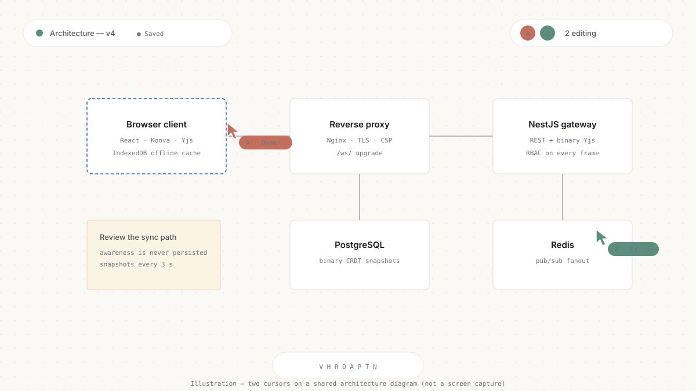
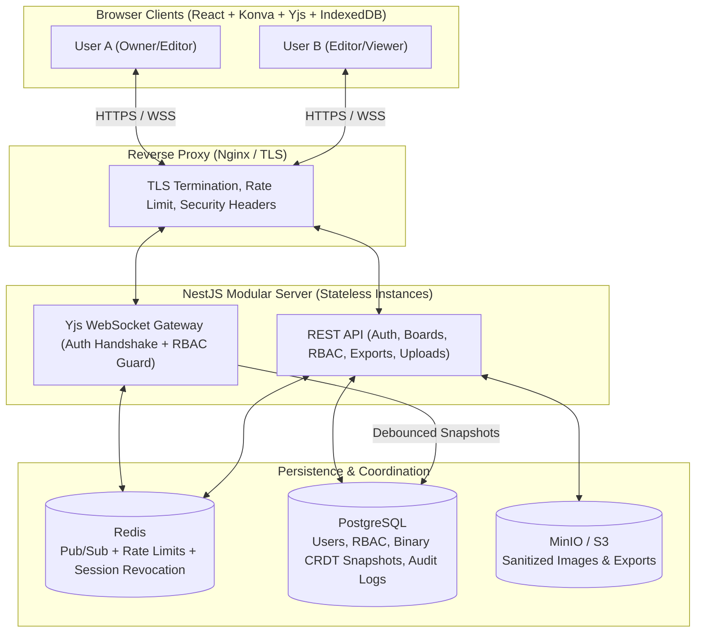

```text
╔══════════════════════════════════════════════════════════════════════╗
║  SyncBoard  ·  a calm, conflict-free canvas for teams             ║
╚══════════════════════════════════════════════════════════════════════╝
```

[](https://github.com/your-org/syncboard/actions/workflows/ci.yml)
[](https://www.typescriptlang.org/)
[](https://pnpm.io/)
[](./LICENSE)
[](./docker/README.md)

> **CI badge note:** the shield tracks `main` once the GitHub remote and Actions are
> configured. Until a successful run is visible, treat it as a link to the workflow file —
> not as proof the suite is green locally.

SyncBoard is a production-grade collaborative whiteboard where shared state is a Yjs CRDT, not a
stream of last-write-wins JSON patches. Stateless NestJS instances, Redis pub/sub fanout, debounced
PostgreSQL snapshots and a four-layer Konva canvas let dozens of people draw together without
overwriting each other or stalling the viewport.



> The preview above is a hand-drawn vector illustration of the interaction model, not a screen
> capture. See `docs/assets/architecture.svg` for the full deployment diagram.

## Engineering highlights

| Concern           | Implementation                                                                                                                                                               | Why it matters                                                             |
| ----------------- | ---------------------------------------------------------------------------------------------------------------------------------------------------------------------------- | -------------------------------------------------------------------------- |
| **CRDT sync**     | `Y.Doc` + Awareness, binary sync handshake through a single-use WS ticket, Redis pub/sub bridge, offline IndexedDB merge                                                     | Concurrent edits converge mathematically; cursors never hit the database.  |
| **60 FPS canvas** | Konva Grid / Static / Active / Overlay layers, rbush viewport culling, memoized shapes, 30 Hz presence with rAF interpolation                                                | Dragging one shape or moving a cursor never re-renders the whole board.    |
| **RBAC**          | Owner → Editor → Commenter → Viewer matrix enforced in HTTP guards _and_ by inspecting every Yjs frame on the WebSocket                                                      | A viewer cannot mutate state even by injecting a crafted binary frame.     |
| **Security**      | Argon2id, rotating HttpOnly refresh tokens with reuse detection, strict CSP/Helmet, Redis sliding-window limits, magic-byte + Sharp upload sanitization, non-root containers | Defense in depth from the browser boundary through the supply chain.       |
| **Persistence**   | Fractional `zIndex`, compacted `BYTEA` snapshots, 3 s debounce / 15 s ceiling, named restore points                                                                          | No row-per-shape write amplification and no concurrent reorder clobbering. |

## Architecture



## Quick start

```bash
# 1. Get the source
git clone https://github.com/your-org/syncboard.git && cd syncboard

# 2. Configure (replace every placeholder with a real value)
cp .env.example .env

# 3. Start PostgreSQL, Redis and MinIO
docker compose up -d

# 4. Install workspace dependencies (Node 22 + pnpm 10)
pnpm install --frozen-lockfile

# 5. Run the API and web app
pnpm dev
```

Open `http://localhost:5173`, register two accounts, and share a board to watch cursors and shapes
sync live.

### Production stack

```bash
cp .env.example .env                            # replace every placeholder
docker compose -f docker-compose.prod.yml up -d --build
```

Only Nginx publishes `80`/`443`. Multi-stage images live at `apps/web/Dockerfile` and
`apps/server/Dockerfile`. Full topology notes: [`docker/README.md`](./docker/README.md).

## Verification

```bash
pnpm lint && pnpm typecheck && pnpm build && pnpm test
pnpm exec playwright test                       # multi-user E2E (needs the dev stack running)
node tests/load/collab-stress.js                # 25-client CRDT convergence harness
```

The Playwright suite uses isolated browser contexts for Owner, Editor and Viewer sessions and reads
client-side Yjs state (with a server observer as oracle). The load harness mints one single-use
ticket per client, broadcasts cursors at 20 Hz, mutates shapes concurrently and fails unless every
client's canonical state hash matches. Details: [`tests/README.md`](./tests/README.md).

> **On benchmark numbers:** latency, FPS and convergence targets come from
> [`docs/REQUIREMENTS.md`](./docs/REQUIREMENTS.md). Where live runs were blocked (e.g. Docker Hub
> 403), [`docs/ENGINEERING_REPORT.md`](./docs/ENGINEERING_REPORT.md) labels figures as
> **estimated / synthetic** — this README does not invent green CI or measured FPS.

## Documentation

- [Requirements & SRS](./docs/REQUIREMENTS.md) — functional, non-functional and security specs.
- [Engineering report](./docs/ENGINEERING_REPORT.md) — architecture decisions, trade-offs, benchmarks, threat model.
- [Security policy](./SECURITY.md) — supported versions and vulnerability disclosure.
- [Docker & deployment](./docker/README.md) — image build, Nginx hardening, production Compose stack.
- [Tests](./tests/README.md) — E2E and load harness usage.

## License

MIT — see [LICENSE](./LICENSE).
